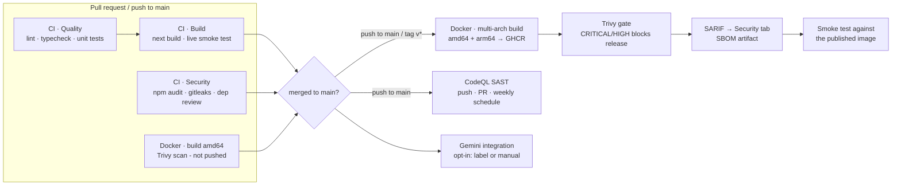

# CI/CD Pipeline — MockMaster

This document explains **every gate in the pipeline, why it exists, and how it fits together**. It doubles as the "story" behind the pipeline — useful for reviews, interviews and onboarding.

---

## Pipeline overview



**Trigger map**

| Workflow | File | When it runs |
|---|---|---|
| CI | `.github/workflows/ci.yml` | every PR, every push to `main` |
| Docker | `.github/workflows/docker.yml` | every PR (validate only), push to `main` + tags `v*.*.*` (publish) |
| CodeQL | `.github/workflows/codeql.yml` | push/PR + weekly schedule (Mondays 05:30 UTC) |
| Gemini integration | `.github/workflows/gemini-integration.yml` | manual run, or PR labelled `ai-integration` |
| Dependabot | `.github/dependabot.yml` | weekly (npm, actions, docker) |

---

## Why each gate exists

### 1. Lint — `npm run lint`
Catches style/bug-pattern issues (unused code, unescaped entities, hook misuse) before humans review them. Keeps review attention on substance. *This gate immediately paid off: enabling it surfaced 20 real errors that had been silently living in the codebase, including a broken production build.*

### 2. Typecheck — `tsc --noEmit`
Type safety is a correctness gate, not decoration. Crucially, this must run **separately from `next build`** so a type error is reported as a type error — with a clean, readable list — rather than a failed 90-second build.

### 3. Unit tests — `vitest` (24 tests)
Fast (<300 ms), deterministic, offline. They cover the pure core of the product:
- the **local faker fallback generator** (the deterministic path CI exercises),
- **slug generation & uniqueness** (mock URLs are the product's core asset),
- **chaos-mode helpers** (error injection at 0% / 100% boundaries, latency),
- **file-backed storage** (CRUD round-trips + restart persistence).

Because CI runs the faker path, **no API key is needed** — CI is free, fast, and never flaky from third-party outages.

### 4. Production build — `next build`
The only honest proof the app compiles for production. `next dev` never type-checks, which is exactly how a broken build sat undetected in this repo before the pipeline existed. The build uses `output: "standalone"` so the same artifact ships to Docker.

### 5. Smoke test — `scripts/smoke-test.mjs`
After the build, CI boots the **real production server** and exercises every API path end-to-end: health, generate, endpoint CRUD, mock serving (GET/POST/PUT/DELETE), 404 handling, input validation, sync, cleanup — 12 assertions. This catches what unit tests can't: routing, serialization, startup crashes, port binding, env issues.

### 6. Dependency audit — `npm audit --audit-level=critical`
Blocks only on **critical** advisories. High/medium findings are surfaced by Dependabot PRs instead of blocking every PR on noisy transitive dependencies — a deliberate signal-to-noise trade-off.

### 7. Secret scan — gitleaks (full git history)
Secrets in git are forever: rotating them is painful and leaks get scraped by bots within minutes of a push. The scan covers **all history**, not just the current diff, so a secret pushed years ago still gets caught. `.gitleaks.toml` allowlists only the `.env.example` placeholder file.

### 8. Dependency review — `actions/dependency-review-action` (PRs only)
A **diff-based** gate: it blocks a PR specifically when the change *introduces* a known-vulnerable dependency or a license incompatible with the project. Complements `npm audit` (whole tree) with per-change precision.

### 9. CodeQL — SAST
Semantic analysis that finds injection patterns, unsafe deserialization, prototype pollution and more — things regex-based tools miss. Runs on push/PR, plus **weekly** so newly-published queries and CVEs retroactively flag existing code.

### 10. Docker image pipeline
- **PRs:** build the image (amd64) and Trivy-scan it, but never push. A `Dockerfile`/`.dockerignore` change can't silently break a release.
- **Push to main / `v*` tags:** build **multi-arch (amd64 + arm64)** — the image runs on both x86 cloud VMs and ARM machines (Graviton, Apple Silicon).
- **Tags are SemVer-aware:** `v2.1.0` → `:2.1.0`, `:2.1`, `:latest`; every push also gets `:sha-<full-commit>` for immutable rollback references.
- **Trivy gate:** CRITICAL/HIGH with a known fix **fails the workflow**; findings also upload as **SARIF → repo Security tab**.
- **SBOM (CycloneDX)** is generated and attached as an artifact — the machine-readable inventory of everything inside the image.
- **Runtime smoke test against the published image:** the final step pulls the image it just pushed and runs the full 12-check suite against it. *Test what you ship.*

### 11. Container hardening
The Dockerfile encodes standard hardening: **multi-stage** (no source, no devDependencies in the final image), **`node:24-alpine`** minimal base, **non-root user**, `HEALTHCHECK` against `/api/health`, and a **separate writable data dir** (`MOCK_DATA_DIR=/app/data`) so persistence works with a volume mount without the app writing into its own code directory.

### 12. Dependabot — npm + actions + docker
Weekly grouped update PRs for app dependencies, GitHub Actions versions, **and the Docker base image**. Update PRs flow through the same CI gates, so a bumped dependency can't break the app silently.

---

## Non-gates (deliberate omissions, with reasons)

- **No "deploy to server" stage yet.** Publishing to GHCR is the natural stopping point: adding a deploy stage later (SSH, Swarm, K8s) consumes the already-tagged image without pipeline redesign.
- **No test coverage threshold.** Coverage is uploaded as an artifact for visibility, but enforcing an arbitrary % early encourages gaming the metric instead of writing meaningful tests.
- **No `npm publish`/release job.** This is an app, not a library; versioned Docker tags *are* the release artifact.

---

## Supply-chain notes

- **Third-party actions pinned to full commit SHAs** (`gitleaks-action@e0c47f4…`, `trivy-action@ed142fd…`). This matters: in March 2026 an attacker force-pushed malicious code onto `trivy-action` version tags (CVE-2026-33634), stealing secrets from repos that referenced floating tags. SHA pins make tag rewrites ineffective; first-party `actions/*` use major version tags and are kept current by Dependabot.
- **`permissions:` scoped per workflow** — `contents: read` for CI, `packages: write` only where the image is pushed. A compromised build step can't push code or publish packages.
- **No secrets in CI by default.** The default token suffices for everything except the opt-in Gemini integration.
- **`.dockerignore` excludes `.env*`** so local secrets can never be baked into an image layer.

---

## Required repository settings (manual, one-time)

Branch protection gives the gates teeth — CI without protection is advisory, CI with protection is law:

1. **Settings → Branches → Add branch protection rule** for `main`:
   - ✅ Require a pull request before merging
   - ✅ Require status checks: `Quality: lint · typecheck · unit tests`, `Build · smoke test (live server)`, `Security: audit · secrets · dependency review`, `Image: build · scan · publish`, `SAST (javascript-typescript)`
   - ✅ Require branches to be up to date before merging
   - ✅ Include administrators
2. **Settings → Secrets and variables → Actions → add `GEMINI_API_KEY`** (from <https://aistudio.google.com/app/apikey>) — needed only for the opt-in Gemini integration workflow.
3. **Settings → Actions → General → Workflow permissions → Read and write permissions** is *not* needed; keep read-only (default) — workflows declare what they need.

## Release process

1. Merge work via PRs (CI + Docker validation + CodeQL gate the merge).
2. On `main`, CI runs again; on success Docker publishes `:main`, `:sha-<commit>`, `:latest` — the image is now deployable.
3. To cut a release: `git tag v1.2.0 && git push origin v1.2.0` → the Docker workflow publishes `:1.2.0`, `:1.1`, `:latest` + SBOM, gated by Trivy and the runtime smoke test.
4. Rollback = deploy the previous immutable `:sha-*` or version tag.

## Running the pipeline locally (parity with CI)

```bash
npm run lint        # gate 1
npm run typecheck   # gate 2
npm run test:unit   # gate 3
npm run build       # gate 4
npm run start &     # boot production server
npm run smoke       # gate 5 — same script CI runs
npm audit --audit-level=critical   # gate 6

docker build -t mockmaster .        # the exact image CI publishes
docker run -p 3000:3000 mockmaster  # health: /api/health
docker compose up --build           # with persistent storage volume
```

If it's green locally, it's green in CI — same Node version (`.nvmrc`), same lockfile (`npm ci`), same scripts.
